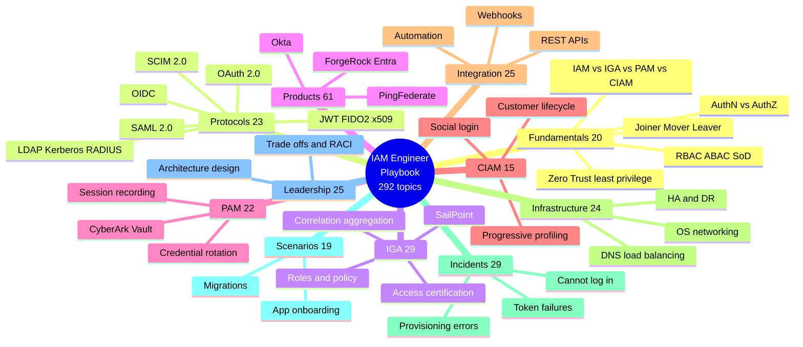
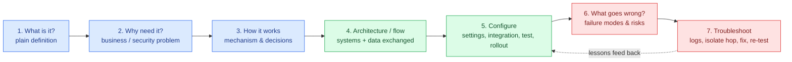
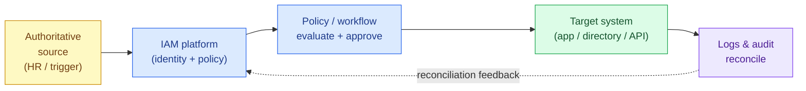
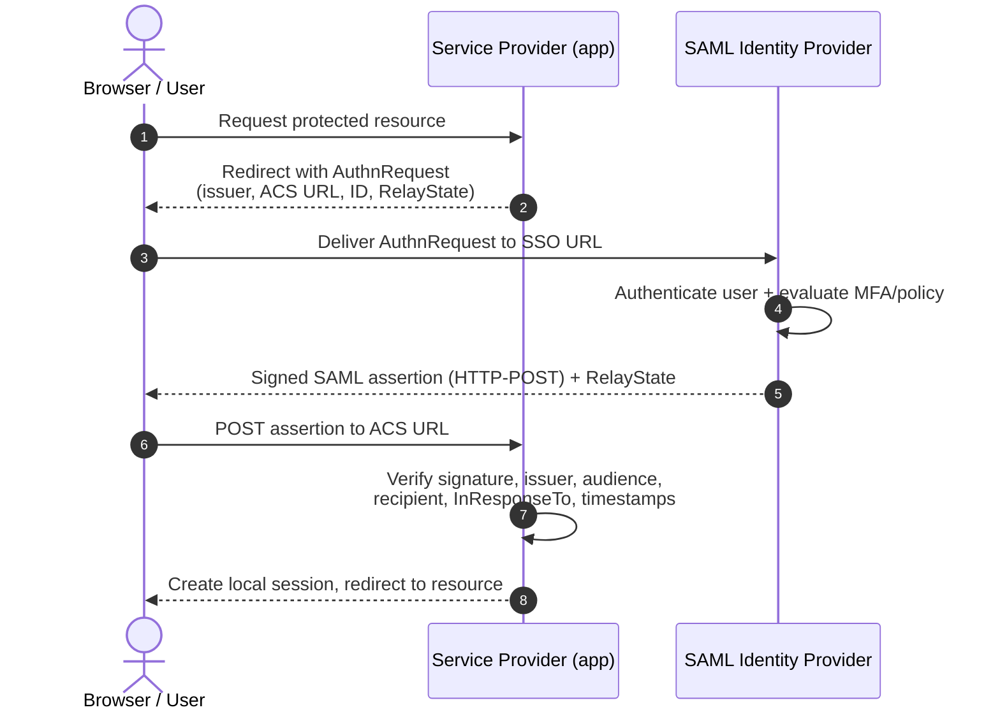
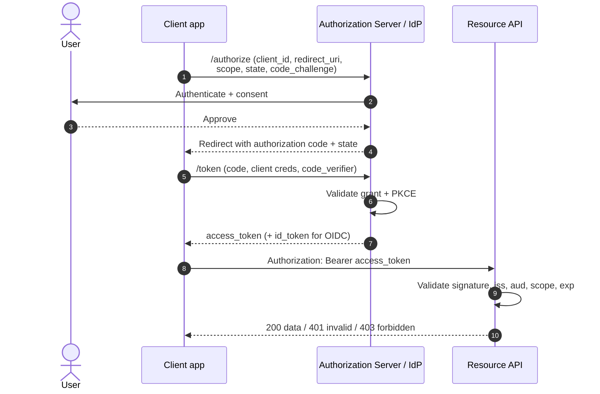
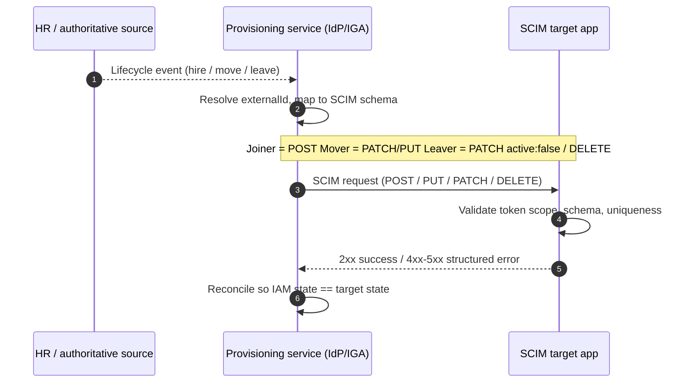
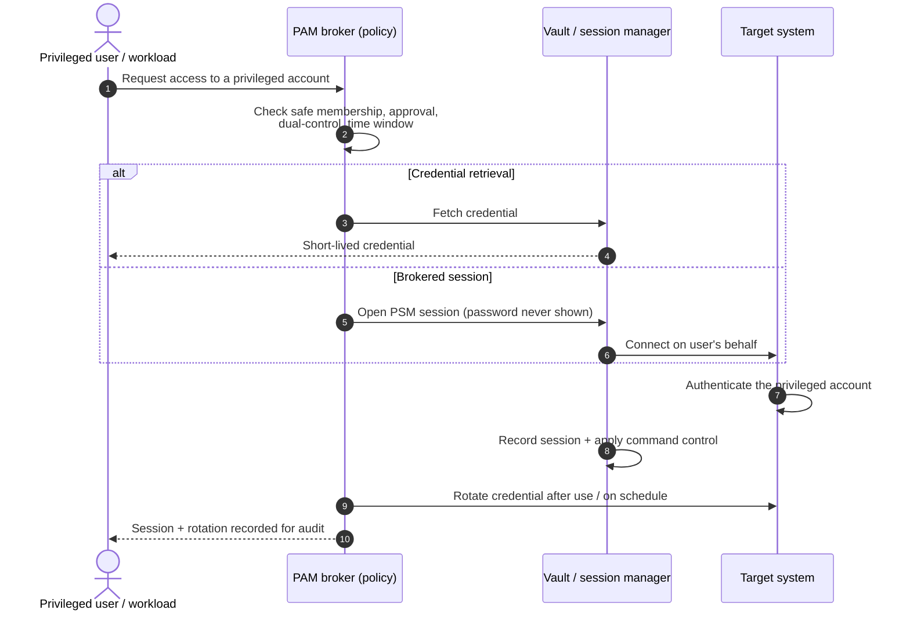
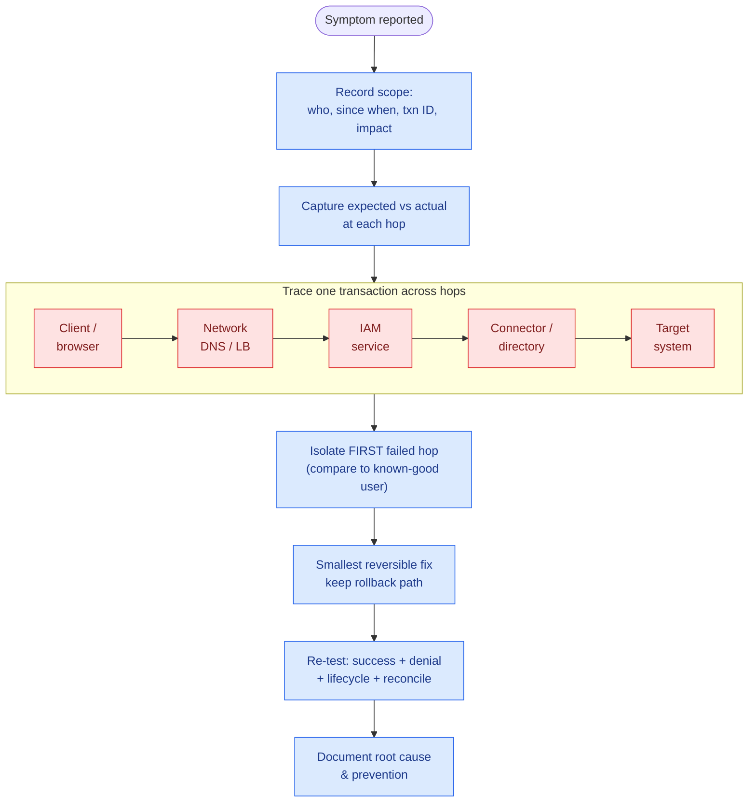
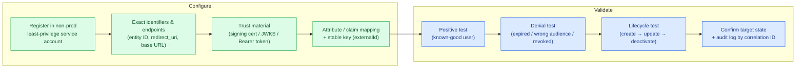

# IAM Engineer Interview — Visual Study Guide

A diagram-first companion to `IAM_Engineer_Interview_Master_Playbook(1).md`.
The playbook holds **292 topics**; this guide gives you the mental models and
flows that let you reason about any of them, even ones you have not memorized.

All diagrams are [Mermaid](https://mermaid.js.org/) and render automatically on
GitHub and in most markdown previewers.

> **Editable version:** the same diagrams are also in [`IAM_Diagrams.drawio`](IAM_Diagrams.drawio)
> (7 pages). Open it with [diagrams.net](https://app.diagrams.net/), the Draw.io
> desktop app, or the VS Code "Draw.io Integration" extension to move, edit, or
> export the shapes.

---

## 1. How the 292 topics are organized

Eleven categories. Learn the *shape* of each category and the individual topics
become variations on a theme.



| Category | Topics | What it is about |
|---|---|---|
| Fundamentals | 20 | Core concepts: identity, access models, lifecycle |
| Protocols | 23 | How systems exchange identity/auth data |
| IGA | 29 | Governance: correlate, certify, provision, prove |
| Products | 61 | Vendor patterns (Okta, Ping, SailPoint, etc.) |
| PAM | 22 | Protecting powerful/privileged accounts |
| CIAM | 15 | Customer-facing identity journeys |
| Integration | 25 | Moving identity data/commands between systems |
| Infrastructure | 24 | OS, network, DNS, HA/DR that IAM depends on |
| Incidents | 29 | Production symptoms and how to isolate them |
| Scenarios | 19 | End-to-end implementation cases |
| Leadership | 25 | Design, trade-offs, delivery, measurement |

---

## 2. The 7-step framework behind every topic

The playbook answers *every* topic with the same seven steps. Memorize the
steps, not 292 separate answers.



**Speaking formula:** "The purpose of **[topic]** is **[problem solved]**. It
works by **[mechanism]**. In a typical flow, **[A]** sends **[data]** to
**[B]**, which validates **[checks]** and then **[outcome]**. I configure
**[settings]**. Common failures include **[examples]**. I troubleshoot by
isolating the failing hop, fixing the root cause, and re-testing."

---

## 3. The core mental model: everything is one transaction

Whatever the topic, it has the same shape — trusted data enters, policy
decides, an action hits a target, the result is logged and reconciled.



---

## 4. Protocols you will be asked about

### SAML 2.0 — SP-initiated SSO

Browser-redirect federation. The assertion trust checks (signature, issuer,
audience, recipient, `InResponseTo`, timestamps) are where interviews and real
incidents concentrate.



### OAuth 2.0 / OIDC — Authorization Code + PKCE

OAuth authorizes **API access** (access token). OIDC adds **authentication**
(id_token). PKCE protects public clients. The resource API validates `iss`,
`aud`, `scope`, and `exp` on every call.



### SCIM — provisioning = Joiner/Mover/Leaver

The lifecycle expressed as a protocol: create, update, deactivate, reconcile.



---

## 5. Privileged Access Management (PAM)

Protect powerful accounts: broker the request against policy, either hand out a
short-lived credential or open a session where the password is never exposed,
record everything, and rotate after use.



---

## 6. Troubleshooting method (the Incidents category)

All 29 incident topics use the same discipline: scope and preserve evidence
first, trace one transaction hop-by-hop, isolate the **first** failed hop before
changing anything, apply the smallest reversible fix, then re-test.



---

## 7. Configure &amp; validate (the Implementation Lab)

Step 5 of the framework — "Configure" — is where most real work and most
interview follow-ups live. The in-app **Implementation Lab** shows a reference
console and an example request/response for each protocol. Whatever you
configure, validate it the same way: exercise a success path *and* a failure
path, then confirm the target state and the audit log.



**Protocol-specific things the lab makes you check (real keywords):**

| Protocol | Configure | Validate on failure |
|---|---|---|
| SAML 2.0 | entity ID, ACS URL, SHA-256 signing cert, NameID format | signature, `Issuer`, `Audience`, `Recipient`, `InResponseTo`, `NotBefore`/`NotOnOrAfter` (clock skew) |
| OAuth / OIDC | exact `redirect_uri`, Auth Code + PKCE, scopes, audience | `invalid_grant` (reused/expired code), `iss`/`aud`/`exp`/signature, `Cache-Control: no-store` |
| SCIM 2.0 | `/Users` &amp; `/Groups`, Bearer token, `externalId` + `userName` | `409` duplicate, `400` invalidSyntax, `401` bad token, `PATCH active:false` offboarding |
| Kerberos | unique SPN, &lt;5 min clock skew, DNS, keytab | `KRB_AP_ERR_SKEW`, `KRB_AP_ERR_MODIFIED`, `S_PRINCIPAL_UNKNOWN` |
| RADIUS | NAS client + shared secret, EAP, return attributes | secret mismatch, UDP 1812/1813 blocked, Access-Reject |
| FIDO2 / WebAuthn | `rpId`, allowed origins, `userVerification` | origin / `rpIdHash` / challenge / signature / signCount replay |
| LDAP / AD | base DN, filters, LDAPS :636, `userAccountControl` | bind `49 data 52e`/`533`/`775`, TLS trust |

---

## 8. Running the study site locally

The playbook content is embedded in `playbook-data.js`, so you can simply open
`index.html` directly in your browser — no server required.

If you prefer to serve it (optional), any static server works:

```bash
python -m http.server 4173   # then open http://localhost:4173
```

The in-app flow diagrams, three mastery levels, and the Implementation Lab are
generated from the embedded playbook at runtime by `app.js`.
